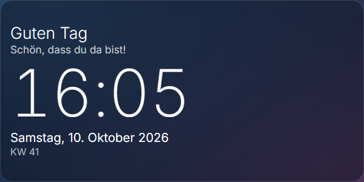

# Uhr mit Begrüßung · Clock with Greeting

**[Deutsch](#deutsch) · [English](#english)** · Plugin für / for [Home Screens](https://github.com/home-screens/home-screens) · v0.1.0

<p align="center"></p>

## Deutsch

Eine **große, helle Uhrzeit** mit tageszeitabhängiger Begrüßung („Guten Morgen“, „Guten Tag“, „Guten Abend“, „Gute Nacht“), ausgeschriebenem Datum und Kalenderwoche. Die Schrift **füllt das Fenster** – egal wie groß du es machst.

### Was kann das Plugin?

- Begrüßung je nach Tageszeit
- Datum ausgeschrieben („Samstag, 10. Oktober 2026“) und Kalenderwoche
- Optional mit Sekunden
- Skaliert automatisch mit der Fenstergröße

### Installation – Schritt für Schritt

**Voraussetzung:** Du hast Home Screens bereits laufen (Server erreichbar im Browser).

1. Öffne den **Editor** deines Home-Screens-Servers im Browser an einem Computer (nicht am Handy; er braucht mindestens 768 Pixel Breite). Die Adresse ist meist `http://<Adresse-deines-Servers>:3000/editor`.
2. Klicke oben in der Leiste auf **Plugins** (neben „Einstellungen“ und „Vorschau“).
3. Klicke auf **Aus URL installieren …**.
4. Füge im Feld **Tarball-URL** diesen Link ein und klicke auf **Installieren**:

   ```
   https://github.com/Gyrosguenter/home-screens-plugin-clock/releases/latest/download/clock-greeting.tar.gz
   ```

   Home Screens weist darauf hin, dass das Plugin „nicht vom Home-Screens-Team geprüft“ ist. Das ist normal, denn es stammt nicht aus dem Marktplatz. Du siehst eine Übersicht, was das Plugin darf.
5. Warte, bis die Installation fertig ist, und klicke auf **Fertig**. Falls das Modul nicht sofort in der Liste auftaucht, lade die Seite neu (F5).
6. Ziehe das Modul auf den Bildschirm: Links in der Liste **MODULE** (Hinweis „Auf den Bildschirm ziehen“) findest du unter **ZEIT & DATUM** das Modul **Uhr mit Begrüßung** (mit der Markierung „Plug-in“). Ziehe es auf deinen Bildschirm und passe Größe und Position an.
7. Klicke das Modul an: rechts erscheinen die **Einstellungen**. Der Editor **speichert automatisch**, einen Speichern-Knopf gibt es nicht.

### Einstellungen

| Einstellung | Bedeutung |
|---|---|
| Begrüßung zeigen | Zeile „Guten Morgen“ usw. über der Uhrzeit. |
| Zusatztext | Zeile unter der Begrüßung, z. B. `Schön, dass du da bist!`. Leer = keine. |
| Sekunden zeigen | Uhrzeit mit Sekunden. |
| Kalenderwoche zeigen | KW unter dem Datum. |

### Aktualisieren

Wiederhole einfach die Installation mit **demselben Link** (Schritte 2–4). Er zeigt immer auf die neueste Version; deine Einstellungen bleiben erhalten.

### Hilfe bei Problemen

- **Uhr zu klein?** Das Fenster größer ziehen – die Schrift passt sich an.
- **Falsche Uhrzeit?** Das Modul nutzt die Uhr des Geräts, das das Display anzeigt (z. B. des Raspberry Pi) und dessen Zeitzone.
- **Installation schlägt fehl?** Dein Home-Screens-Server muss auf `github.com` zugreifen können (Internet). Prüfe, ob der Link vollständig kopiert wurde.
- **Modul bleibt leer nach dem Ziehen?** Seite neu laden (F5). Ein paar Sekunden warten, manche Module laden Daten erst nach dem Einfügen.

### Datenschutz und Hinweise

Das Modul sendet nichts ins Internet.

---

## English

A **large, light clock** with a time-of-day greeting ("Good morning" …), the full date and the week number. The text **fills the window** no matter how big you make it. (Greeting text is in German.)

### What does it do?

- Greeting depending on time of day
- Full date and calendar week
- Optional seconds
- Scales automatically with the window size

### Installation – step by step

**Prerequisite:** Home Screens is already running (server reachable in the browser).

1. Open the **editor** of your Home Screens server in a browser on a computer (not a phone; it needs at least 768 pixels width). The address is usually `http://<address-of-your-server>:3000/editor`.
2. Click **Plugins** in the top bar (next to "Settings" and "Preview").
3. Click **Install from URL…**.
4. Paste this link into the **Tarball URL** field and click **Install**:

   ```
   https://github.com/Gyrosguenter/home-screens-plugin-clock/releases/latest/download/clock-greeting.tar.gz
   ```

   Home Screens warns that the plugin "has not been reviewed by the Home Screens team". That is normal because it does not come from the marketplace. You will see an overview of what the plugin may do.
5. Wait until the installation has finished and click **Done**. If the module does not show up in the list immediately, reload the page (F5).
6. Drag the module onto the screen: in the **MODULES** list on the left ("Drag onto the screen") find **Uhr mit Begrüßung** under **TIME & DATE** (marked "Plugin"). Drag it onto your screen and adjust size and position.
7. Click the module: the **settings** appear on the right. The editor **saves automatically**; there is no save button.

### Settings

| Setting | Meaning |
|---|---|
| Show greeting | The "Good morning" line above the time. |
| Subtitle | Line under the greeting, e.g. `Nice to have you here!`. Empty = none. |
| Show seconds | Time with seconds. |
| Show calendar week | Week number under the date. |

### Updating

Simply repeat the installation with the **same link** (steps 2–4). It always points to the latest version; your settings are kept.

### Troubleshooting

- **Clock too small?** Drag the window larger – the text adapts.
- **Wrong time?** The module uses the clock and time zone of the device showing the display (e.g. the Raspberry Pi).
- **Installation fails?** Your Home Screens server must be able to reach `github.com` (internet). Check that the link was copied completely.
- **Module stays empty after dragging?** Reload the page (F5). Wait a few seconds; some modules fetch data only after being added.

### Privacy and notes

The module sends nothing to the internet.

---

## Technik / Technical notes

- **ID / Manifest:** `clock-greeting` – Version 0.1.0, License MIT
- Bauen / Build: `npm install && npm run build && npm test`
- Release-Archiv für die Installation / Release archive used for installation: `clock-greeting.tar.gz` (enthält / contains `clock-greeting/manifest.json` + `clock-greeting/dist/bundle.js`)
- Teil eines privaten Heim-Projekts (Magic-Mirror-Ersatz); als eigenes öffentliches Repo geführt, damit die Installations-URL ohne Anmeldung erreichbar ist / Part of a private home project (Magic Mirror replacement); kept as its own public repo so the install URL works without login.
- Dieses Plugin ist ein inoffizielles Community-Plugin und steht in keiner Verbindung zum Home-Screens-Team / This is an unofficial community plugin and is not affiliated with the Home Screens team.

MIT
